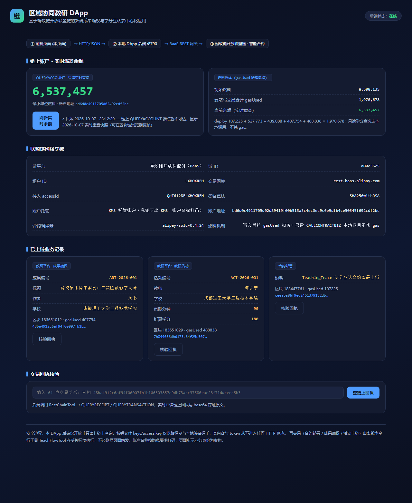
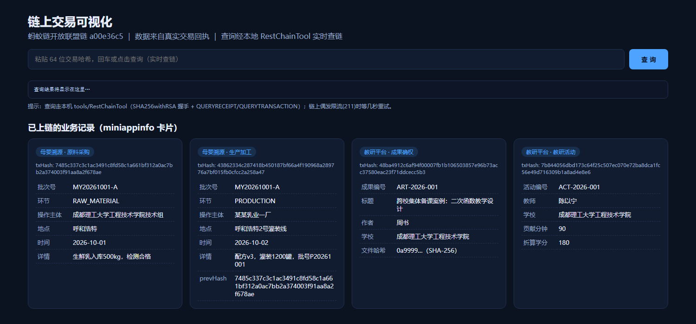
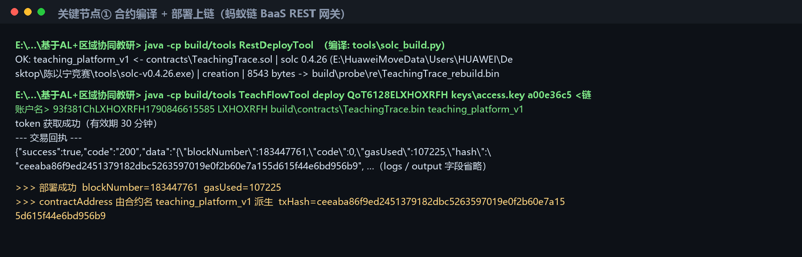
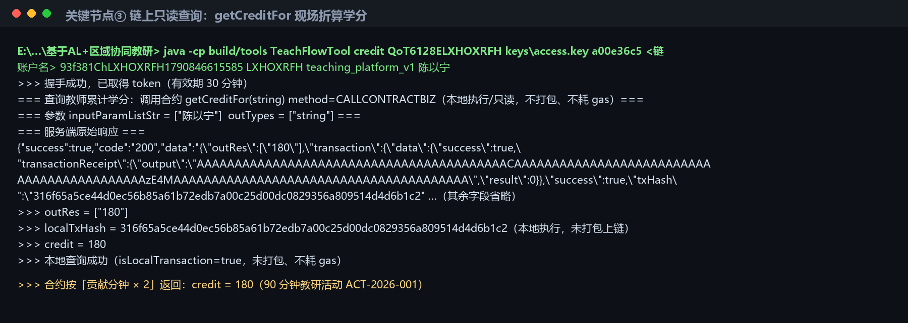

# 基于 AI+区块链的区域协同教研平台 · 复现手册

> **在线静态展示页（GitHub Pages）**：https://wszaxl.github.io/ai-blockchain-teaching-platform/
> **源码仓库（公开）**：https://github.com/wszaxl/ai-blockchain-teaching-platform

## 〇、项目界面预览

| DApp 前端大屏 | 链上交易可视化大屏 |
| --- | --- |
|  |  |

| 编译与部署终端 | 学分查询终端 |
| --- | --- |
|  |  |

本文件夹是该项目的**完整可复现资产包**（第二个项目）。任何一台能上网的 Windows 电脑 +
本文件夹，即可复现「查证链上交易 → 重编译合约 → 调用合约 → 学分 180」全流程。

## 一、文件夹结构

```
基于AL+区域协同教研/
├── docs/教研平台/                    设计、接口文档、过程实录、三张图、PDF 技术文档、方案 PPT
├── contracts/TeachingTrace.sol      智能合约源码（注释与代码逐段对应）
├── build/contracts/TeachingTrace.bin 已编译字节码（可直接重新部署）
├── build/tools/*.class              已编译工具（java -cp 直接运行，无需 javac）
├── tools/                           工具源码 + solc 编译器（改代码后可重新编译）
├── keys/access.key                  AccessKey 私钥（仅本机演示用，参赛提交时请勿打包）
├── scripts/                         PDF/PPT 再生成脚本
├── dapp/                            DApp：backend 链访问后端 + frontend 前端页面
├── build/probe/                     链上过程证据原始存档
└── README-复现手册.md
```

## 二、一分钟复现（最关键的三条命令）

前置：命令行先进入本文件夹（按实际路径）：

```powershell
cd 'E:\HuaweiMoveData\Users\HUAWEI\Desktop\基于AL+区域协同教研'
```

### 1. 现场验证「学分 = 180」（SDK 运行视频的核心镜头）

> 命令中的 `<链账户名>` 为本租户唯一 KMS 托管链账户的名称：按隐私要求本文档已打码，
> 复现时登录蚂蚁链控制台「链账户管理」查看该唯一账户名并填入即可。

```powershell
java -cp build\tools TeachFlowTool credit QoT6128ELXHOXRFH keys\access.key a00e36c5 <链账户名> 93f381ChLXHOXRFH1790846615585 LXHOXRFH teaching_platform_v1 陈以宁
```

预期末尾出现：

```
>>> outRes = ["180"]
>>> credit = 180
```

### 2. 查证链上三笔交易（只读，不耗 gas）

```powershell
java -cp build\tools RestChainTool query QoT6128ELXHOXRFH keys\access.key a00e36c5 ceeaba86f9ed2451379182dbc5263597019e0f2b60e7a155d615f44e6bd956b9
java -cp build\tools RestChainTool query QoT6128ELXHOXRFH keys\access.key a00e36c5 48ba4912c6af94f00007fb1b106503857e96b73acc37580eac23f71ddcecc5b3
java -cp build\tools RestChainTool query QoT6128ELXHOXRFH keys\access.key a00e36c5 7b844056dbd173c64f25c507ec070e72ba8dca1fc56e49d716309b1a8ad4e8e6
```

### 3. 查账户余额（对账：初始 8,508,135 − 五笔 gas = 6,537,457）

```powershell
java -cp build\tools RestChainTool account QoT6128ELXHOXRFH keys\access.key a00e36c5 <链账户名>
```

> 注意：`account` 子命令的最后一个参数是**链账户名**（KMS 托管账户名称，已打码），不是教师名。
> 账户地址 = SHA256(链账户名) = `bd6d0c49…cdf2bc`。链上 QUERYACCOUNT 端点偶发不可达时，
> 以 2026-10-07 实时重查快照 `6537457` 为准（可在区块链浏览器复核）。

## 三、链上资产速查（开放联盟链 a00e36c5）

| 资产 | 值 |
| --- | --- |
| 链 ID | a00e36c5（**不是** 141a48c42f1e47b085a4502dab442553 合约体验链） |
| 托管账户 | `<链账户名>`（名称按隐私要求打码；地址 = SHA256(账户名) = `bd6d0c49…cdf2bc`。教师业务身份为虚构的「陈以宁/周书」，与链账户名不同） |
| 租户 ID | LXHOXRFH |
| AccessKey ID | QoT6128ELXHOXRFH |
| KMS KeyId | 93f381ChLXHOXRFH1790846615585 |
| 教研合约 | teaching_platform_v1 |
| 部署交易 | ceeaba86f9ed2451379182dbc5263597019e0f2b60e7a155d615f44e6bd956b9 |
| 成果确权 | 48ba4912c6af94f00007fb1b106503857e96b73acc37580eac23f71ddcecc5b3 |
| 教研活动 | 7b844056dbd173c64f25c507ec070e72ba8dca1fc56e49d716309b1a8ad4e8e6 |

## 四、想重编译 / 改代码

合约（需要 Python 3）：

```powershell
python tools\solc_build.py contracts\TeachingTrace.sol build\contracts\TeachingTrace.bin
```

工具（需本机 javac）：

```powershell
javac -encoding UTF-8 -nowarn -d build\tools tools\TeachFlowTool.java tools\RestChainTool.java tools\RestDeployTool.java
```

## 五、文档再生成

- PDF：`python scripts\build_pdf_teach.py`（需 pip 装 reportlab；字体用系统 simsun/simhei）
- PPT：`python scripts\build_ppt_teach.py`（需 pip install python-pptx）

## 六、视频三件套（唯一人工环节）

分镜脚本与口播稿见 `docs/教研平台/07-过程实录与视频拍摄脚本.md` 第 2.1~2.3 节。
按脚本录屏即可；"联盟链搭建过程"以【控制台配置 + 以上部署/调用实录】替代，解释口径见
过程实录文档。现场可反复执行的安全命令只有三条只读（上述第一条必看）。

## 七、DApp 前端与后端（本地运行）

三层结构：前端页面 → 本地 DApp 后端(:8790) → BaaS REST 网关 → 智能合约。

```powershell
python dapp\backend\dapp_server.py
```

然后浏览器打开 `http://127.0.0.1:8790/`。页面会实时展示链上账户燃料余额、联盟链参数与
已上链业务记录；在「交易回执核验」框输入任意 64 位交易哈希（或直接访问
`http://127.0.0.1:8790/?hash=<64位哈希>`）即回读链上回执与 base64 存证原文。

- 后端只开放**只读**查询（QUERYACCOUNT / QUERYRECEIPT / QUERYTRANSACTION）；
- 私钥 `keys/access.key` 仅以路径参与本地签名握手，内容与 token 不进入任何 HTTP 响应；
- 写交易不经联网页面触发，仍用离线 `TeachFlowTool`；
- 如需「实时余额」而非快照，本机以环境变量提供链账户名后启动：
  `set DAPP_ACCOUNT_NAME=<链账户名>` 再运行上面的 python 命令（账户名打码，勿写入任何文件）。

## 八、安全提醒

- `keys/access.key` 是私钥：**参赛提交压缩包时请删除 keys/ 目录**，只在演示机器上保留；
- `工作档案/` 为内部工作笔记（含未打码的原始链账户名等过程信息），**参赛提交时一并排除**，
  只提交 docs/、contracts/、build/、tools/、scripts/、dapp/ 与本 README；
- 浏览器查询交易时，链务必选「开放联盟链 a00e36c5」，选错链会显示"查无此交易"。